# Comprehensive Functional Specification & End-to-End Workflow Engineering Report

**Project Title:** Government Scheme Eligibility Engine (GSEE)  
**System Classification:** Full-Stack Intelligent e-Governance Decision Support Platform  
**Live Production Deployments:**
- **Citizen Portal (Frontend):** [https://base-start-red.vercel.app](https://base-start-red.vercel.app)
- **Backend API Server:** [https://base-start.onrender.com](https://base-start.onrender.com)
- **Cloud Database:** MongoDB Atlas (`government_scheme_db`)

---

## Table of Contents
1. [Executive Summary & Purpose](#1-executive-summary--purpose)
2. [Global System Architecture Diagram](#2-global-system-architecture-diagram)
3. [Module-by-Module Detailed Functional Specifications](#3-module-by-module-detailed-functional-specifications)
4. [Master End-to-End Workflow Diagrams](#4-master-end-to-end-workflow-diagrams)
   - [Workflow 1: Citizen Onboarding & Profile Setup](#workflow-1-citizen-onboarding--profile-setup)
   - [Workflow 2: Scheme Discovery & Multi-Facet Filtering](#workflow-2-scheme-discovery--multi-facet-filtering)
   - [Workflow 3: Deterministic Eligibility Evaluation (Single & Batch)](#workflow-3-deterministic-eligibility-evaluation-single--batch)
   - [Workflow 4: Conversational Scheme Assistant (RAG Pipeline)](#workflow-4-conversational-scheme-assistant-rag-pipeline)
   - [Workflow 5: Hybrid Personalized Scheme Recommendation](#workflow-5-hybrid-personalized-scheme-recommendation)
   - [Workflow 6: Application Reminder & Automated Cron Notification](#workflow-6-application-reminder--automated-cron-notification)
   - [Workflow 7: Citizen Grievance Clustering & Policy Escalation](#workflow-7-citizen-grievance-clustering--policy-escalation)
   - [Workflow 8: Admin Scheme Publishing & Visual Rule Configuration](#workflow-8-admin-scheme-publishing--visual-rule-configuration)
5. [State Transition Lifecycle Models](#5-state-transition-lifecycle-models)
6. [Complete Database Entity-Relationship (ER) Model](#6-complete-database-entity-relationship-er-model)
7. [Role-Based Access Control (RBAC) Interaction Matrix](#7-role-based-access-control-rbac-interaction-matrix)
8. [Fault Tolerance, Edge Cases & Resilience Mechanisms](#8-fault-tolerance-edge-cases--resilience-mechanisms)

---

## 1. Executive Summary & Purpose

The **Government Scheme Eligibility Engine (GSEE)** is designed to eliminate information fragmentation in Indian welfare administration. In traditional systems, citizens must navigate disconnected department websites, decipher complex gazette eligibility rules, and frequently miss critical application deadlines.

GSEE solves these challenges through a unified platform featuring:
1. **A verified catalog of 1,062 Central and State government schemes** organized by administering ministries and departments.
2. **A 100% deterministic Symbolic Rule Engine** assessing citizen eligibility with transparent, mathematical explanations.
3. **An AI Scheme Assistant** powered by Alibaba's **Qwen 2.5 Instruct LLM** utilizing **Retrieval-Augmented Generation (RAG)** to provide factual, non-hallucinated answers.
4. **A Hybrid Personalized Recommender** tailoring welfare discovery based on user search patterns and demographic criteria.
5. **An Automated Background Cron Scheduler** managing deadline sweeps and in-portal citizen alerts.
6. **An Unsupervised Grievance Clustering Engine** detecting policy bottlenecks when repeated citizen complaints are filed.

---

## 2. Global System Architecture Diagram

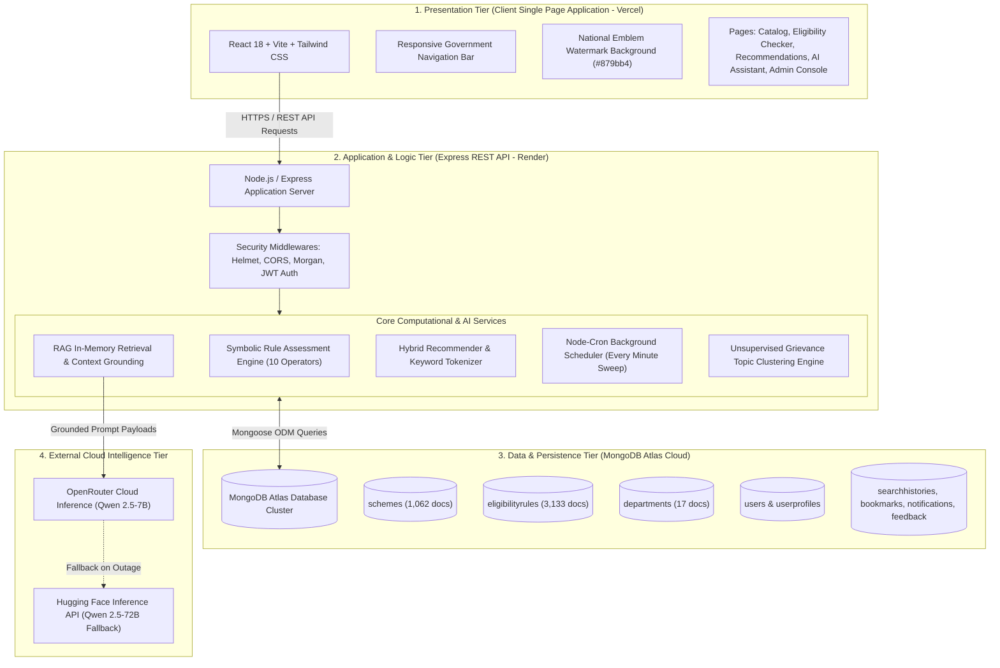

---

## 3. Module-by-Module Detailed Functional Specifications

### Module 1: Authentication, Security & Citizen Profile Parameterization
- **Purpose**: Authenticates citizens and administrators while maintaining an auditable demographic profile used for automated assessments.
- **Key Operations**:
  - `POST /api/auth/register`: Creates citizen account with bcrypt salted password hashing (rounds = 10).
  - `POST /api/auth/login`: Issues a signed JSON Web Token (JWT) with standard expiration.
  - `GET /api/profiles/me` & `PUT /api/profiles/me`: Manages 10 citizen parameters:
    - `dateOfBirth`: Used to dynamically derive real-time age.
    - `gender`: Male / Female / Transgender.
    - `state` & `district`: Geographic residency matching.
    - `annualFamilyIncome`: Numeric threshold comparison against statutory limits.
    - `education` & `occupation`: Target beneficiary alignment (e.g., Student, Small Farmer).
    - `employmentStatus`: Employed, Self-Employed, Unemployed, etc.
    - `community`: General, OBC, SC, ST, EWS, Minority.
    - `disabilityStatus`: Boolean indicator for Divyangjan benefits.
    - `otherDetails`: Flexible store for land ownership and document proofs.

---

### Module 2: Scheme & Department Catalog Discovery Module
- **Purpose**: High-performance, multi-parameter directory of **1,062 Central & State initiatives** linked directly to **17 government departments**.
- **Key Operations**:
  - `GET /api/schemes`: Paginated and filtered search supporting:
    - Text search over `schemeName`, `category`, `shortDescription`, `ministry`, `targetBeneficiaries`.
    - Dropdown filters for `departmentId`, `category`, `state`, `schemeLevel` (Central vs. State), and `beneficiary`.
    - Sorting by `newest`, `oldest`, `name_asc` (A-Z), and `name_desc` (Z-A).
  - `GET /api/schemes/:id`: Comprehensive details including structured financial benefits, eligibility criteria summary, required documents list, application process steps, and direct official application URL.
  - `GET /api/departments`: Directory of parent ministries, contact details, official web portals, and associated schemes count.

---

### Module 3: Deterministic Rule-Based Eligibility Assessment Module
- **Purpose**: Evaluates applicant attributes against scheme rules using mathematical and set-theoretic operators without probabilistic machine learning errors.
- **Supported Relational Operators**:
  1. `==`: Exact equality (e.g., `gender == "Female"`).
  2. `!=`: Exclusivity (e.g., `employmentStatus != "Government Employee"`).
  3. `>` & `>=`: Lower-bound numeric comparisons (e.g., `age >= 18`).
  4. `<` & `<=`: Upper-bound numeric ceilings (e.g., `annualFamilyIncome <= 250000`).
  5. `IN`: Set inclusion (e.g., `community IN ["SC", "ST", "OBC"]`).
  6. `NOT_IN`: Disqualification sets (e.g., `occupation NOT_IN ["Income Tax Payee"]`).
  7. `BETWEEN`: Closed interval verification (e.g., `age BETWEEN [18, 35]`).
  8. `EXISTS`: Document or record verification (e.g., `aadhaarLinked EXISTS`).
- **Modes of Assessment**:
  - **Single Scheme Evaluation** (`POST /api/eligibility/check-scheme/:id`): Deep, rule-by-rule breakdown detailing rule name, user profile value, statutory condition, pass/fail status, and plain-English explanation.
  - **Batch Evaluation Across All Schemes** (`POST /api/eligibility/check-all`): Concurrently evaluates applicant data across all 1,062 active schemes in a single pass, partitioning results into `Eligible Schemes`, `Ineligible Schemes`, and `Incomplete Schemes`.

---

### Module 4: Conversational Scheme Assistant (Qwen 2.5 + RAG Module)
- **Purpose**: Citizen chatbot answering complex, natural-language scheme questions without fabricating benefits.
- **Technical Pipeline**:
  1. **Query Tokenization & Stop-Word Stripping**: Strips general filler words and domain stop-words (*yojana, scheme, online, apply*) to extract core search intent.
  2. **In-Memory Information Retrieval**: Queries MongoDB for top-4 verified schemes matching extracted tokens across name, category, objectives, and beneficiary attributes.
  3. **Context Assembly**: Compiles verified database facts (Ministry, Benefits, Conditions, Documents, Official Links) alongside logged-in citizen demographics into a structured prompt block.
  4. **Generative Synthesis**: Passes the assembled context to **Qwen 2.5-7B-Instruct** with low temperature (`0.3`) and negative instruction constraints.
  5. **Offline Grounded Fallback**: If external APIs fail, a local fallback synthesizer (`generateGroundedResponse`) extracts verified structured bullet points directly from the database objects.

---

### Module 5: Hybrid RAG Personalized Scheme Recommender Module
- **Purpose**: Automatically presents high-relevance schemes to logged-in citizens based on search behavior and demographic fit.
- **Algorithmic Flow**:
  - Analyzes the citizen's latest 15 telemetry records from `SearchHistory` and viewed schemes.
  - Generates an active interest keyword vector $\mathcal{K}_u$.
  - Fetches candidate schemes and applies hard state-residency constraints.
  - Evaluates candidates through the **Rule Engine** to strictly discard schemes for which the citizen is legally disqualified.
  - Ranks surviving schemes using:
    $$\text{Score}(s) = (\text{Keyword Hits} \times 10) + (\text{Unviewed Bonus: } 5)$$
  - Maps score to a confidence percentage displayed in 3 distinct portal tabs:
    - *All Recommended*: Combined ranked recommendations.
    - *From Your Searches*: Schemes matching recent search intent.
    - *From Your Profile*: Schemes matching occupation, caste, and income.

---

### Module 6: Bookmarks & Priority Schemes Management Module
- **Purpose**: Allows citizens to curate a personal portfolio of schemes they intend to apply for.
- **Key Operations**:
  - `POST /api/bookmarks`: Adds a scheme to user's saved list.
  - `DELETE /api/bookmarks/:schemeId`: Removes a scheme from bookmarks.
  - `GET /api/bookmarks`: Displays all saved initiatives with real-time indicators for active application deadlines.

---

### Module 7: Application Reminders & Automated Background Cron Engine
- **Purpose**: Prevents citizens from missing scheme application cut-off dates.
- **Key Operations & Mechanisms**:
  - `POST /api/reminders`: Citizen schedules a specific date/time alert with custom notes for any bookmarked scheme.
  - **Cron Execution (`scheduler.js`)**: Executes every minute (`* * * * *`).
  - **Reconciliation Sweep**: Scans `bookmarks` collection for documents where:
    - `reminder.enabled === true`
    - `reminder.status === 'UPCOMING'`
    - `reminder.reminderDate <= new Date()`
  - **Action**: Generates an in-portal `Notification` record and transitions reminder status to `TRIGGERED`.
  - **Safe Startup Sweep**: Executes immediately upon server boot to catch any reminders that came due during maintenance or downtime.

---

### Module 8: Citizen Feedback Clustering & Grievance Policy Desk
- **Purpose**: Converts citizen feedback into actionable policy intelligence for portal administrators.
- **Algorithmic Flow**:
  - Citizens submit feedback or report that a particular rule is too harsh via `POST /api/feedback`.
  - The system analyzes grievance text using regex classifiers and categorizes it into canonical operational topics (`income_limit`, `age_criteria`, `land_holding`, `documentation`, `community_category`, `gender_criteria`, `portal_link`).
  - Compounds the key: `SchemeId + FeedbackType + CanonicalTopic`.
  - When **$\ge 5$ distinct registered citizens** report the same issue, the system automatically creates an `AdminRecommendation` card.
  - The card displays an alert to officials, lists citizen complaints, and offers a 1-click link to adjust the threshold in the Rule Builder.

---

### Module 9: Admin Console, Verification & Visual Rule Builder
- **Purpose**: Administrative interface for scheme lifecycle governance and condition configuration.
- **Key Features**:
  - **Scheme Lifecycle Management**: Create, edit, draft, and publish schemes.
  - **Visual Rule Builder**: Interface allowing non-technical officials to select a field, choose an operator, input an expected value, set mandatory flags, and publish rules without writing code.
  - **Scheme Verification Desk**: Audit queue where administrators verify official government circulars, update verification badges (`VERIFIED`), and confirm portal URLs.
  - **User & Audit Management**: Monitor citizen registrations, manage accounts, and inspect immutable audit logs for all administrative actions.

---

## 4. Master End-to-End Workflow Diagrams

### Workflow 1: Citizen Onboarding & Profile Setup

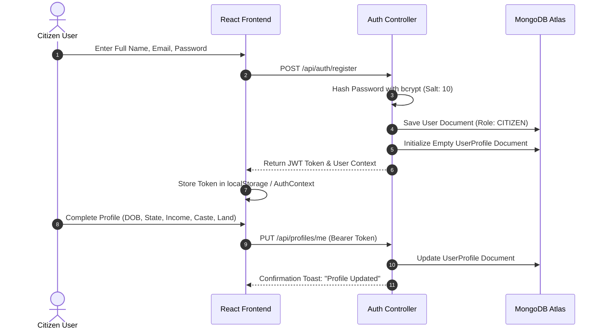

---

### Workflow 2: Scheme Discovery & Multi-Facet Filtering

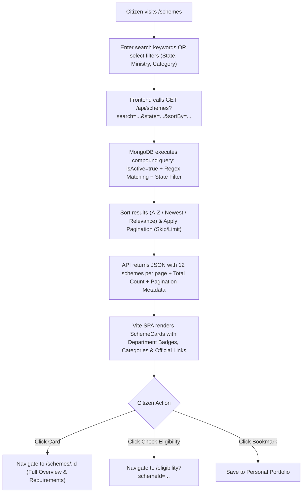

---

### Workflow 3: Deterministic Eligibility Evaluation (Single & Batch)

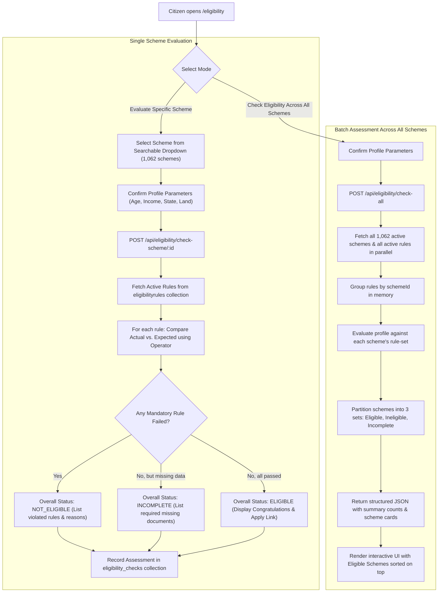

---

### Workflow 4: Conversational Scheme Assistant (RAG Pipeline)

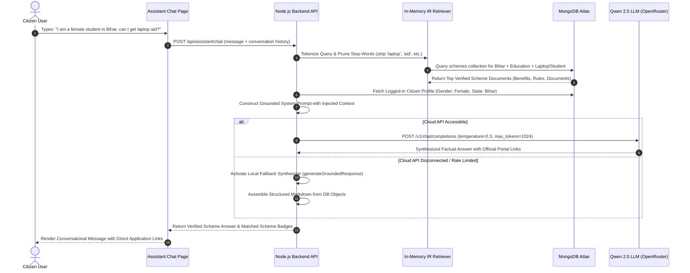

---

### Workflow 5: Hybrid Personalized Scheme Recommendation

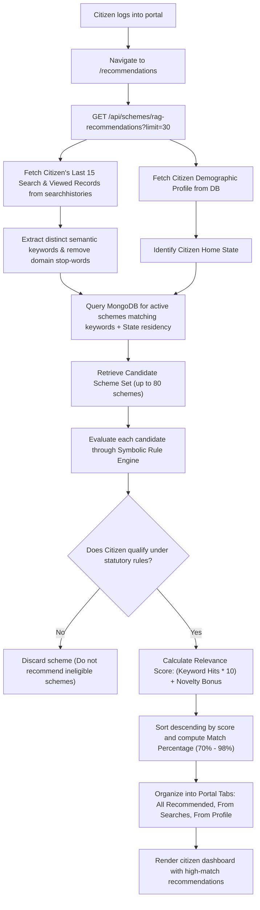

---

### Workflow 6: Application Reminder & Automated Cron Notification

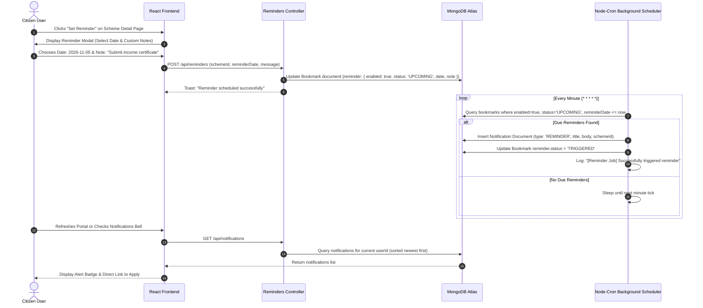

---

### Workflow 7: Citizen Grievance Clustering & Policy Escalation

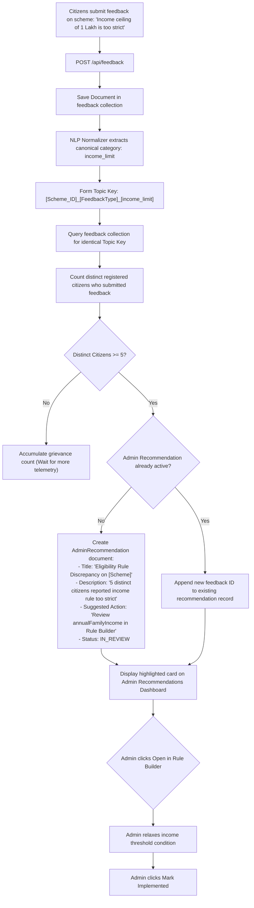

---

### Workflow 8: Admin Scheme Publishing & Visual Rule Configuration

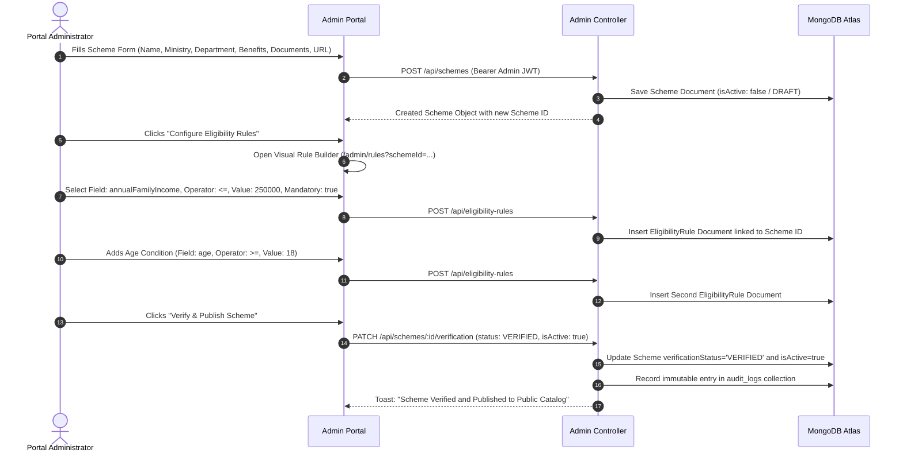

---

## 5. State Transition Lifecycle Models

### 5.1 Scheme Eligibility Lifecycle

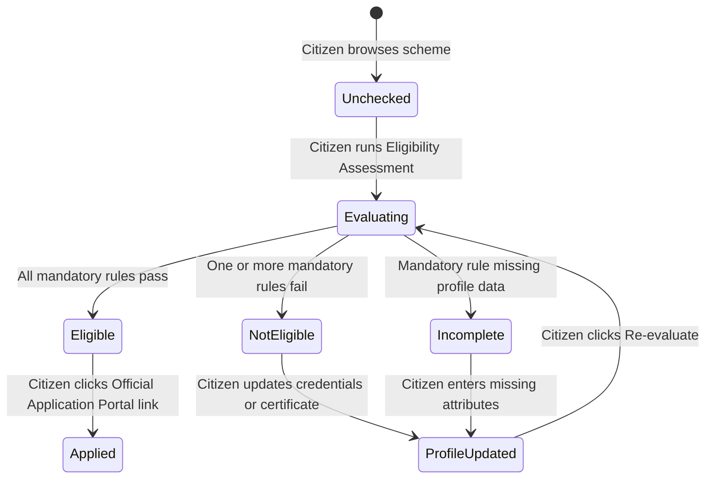

### 5.2 Application Reminder Lifecycle

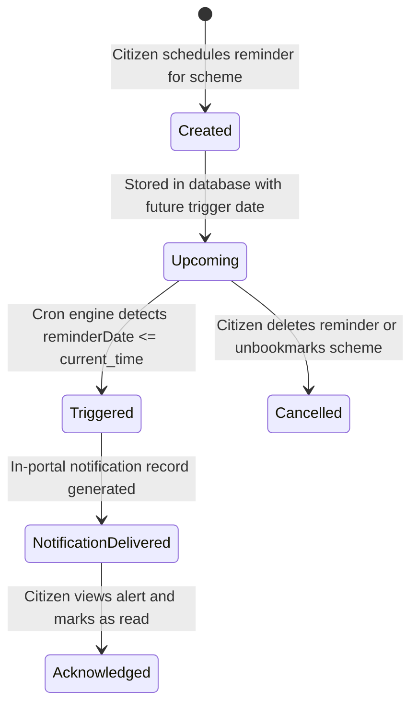

---

## 6. Complete Database Entity-Relationship (ER) Model

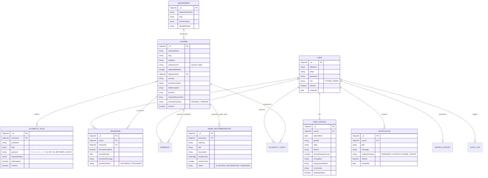

---

## 7. Role-Based Access Control (RBAC) Interaction Matrix

| Platform Capability | Public Guest (Unauthenticated) | Registered Citizen User | Portal Administrator |
| :--- | :---: | :---: | :---: |
| **Browse 1,062 Scheme Directory** | ✅ Yes | ✅ Yes | ✅ Yes |
| **Filter by Ministry / State / Category** | ✅ Yes | ✅ Yes | ✅ Yes |
| **Single Scheme Eligibility Assessment** | ✅ Yes (Manual input form) | ✅ Yes (Auto-fills from profile) | ✅ Yes |
| **Batch Eligibility Assessment Across All Schemes** | ❌ Requires Profile / Login | ✅ Yes (1-Click Evaluation) | ✅ Yes |
| **AI Scheme Assistant (Conversational Chatbot)** | ✅ Yes (Guest context) | ✅ Yes (Personalized demographic context) | ✅ Yes |
| **Personalized Hybrid Recommendations** | ❌ No | ✅ Yes (Profile & Search driven) | ✅ Yes |
| **Save Schemes / Manage Bookmarks** | ❌ No | ✅ Yes | ✅ Yes |
| **Schedule Application Reminders** | ❌ No | ✅ Yes | ✅ Yes |
| **Receive In-Portal Deadline Notifications** | ❌ No | ✅ Yes | ✅ Yes |
| **Submit Scheme Grievance & Feedback** | ❌ No | ✅ Yes | ✅ Yes |
| **Create / Edit / Publish Schemes** | ❌ No | ❌ Forbidden | ✅ Full Admin Access |
| **Create & Modify Rules in Visual Rule Builder** | ❌ No | ❌ Forbidden | ✅ Full Admin Access |
| **Inspect Citizen Grievance Clustering Desk** | ❌ No | ❌ Forbidden | ✅ Full Admin Access |
| **Audit Logs & Verification Management** | ❌ No | ❌ Forbidden | ✅ Full Admin Access |

---

## 8. Fault Tolerance, Edge Cases & Resilience Mechanisms

### 8.1 Cloud AI API Latency & Outage Resilience
- **Challenge**: External LLM inference APIs (OpenRouter / Hugging Face) may experience network timeouts or rate-limiting during peak usage.
- **Solution**: GSEE includes an automated fallback pipeline. If the primary cloud inference endpoint does not respond within 5,000ms or returns an HTTP error, the system automatically redirects execution to the local grounder (`generateGroundedResponse`). This engine constructs structured, verified markdown responses directly from the MongoDB schema, ensuring the chatbot never crashes.

### 8.2 Safe Server Restart & Overdue Reminder Recovery
- **Challenge**: If the backend server restarts for deployment or maintenance, scheduled reminders that came due during downtime could be missed.
- **Solution**: The `initReminderScheduler()` function executes an immediate database sweep (`processDueReminders()`) upon initialization before activating the standard per-minute cron listener. Any reminders with `reminderDate <= new Date()` and status `'UPCOMING'` are immediately processed and notifications dispatched.

### 8.3 Legal Explainability & Mandatory Condition Gating
- **Challenge**: An applicant might meet 4 optional criteria (e.g., student status, correct state, valid ID) but exceed the maximum family income limit.
- **Solution**: The Symbolic Rule Engine classifies rules into `isMandatory: true` and `isMandatory: false`. If even a single mandatory threshold fails, the system strictly outputs `NOT_ELIGIBLE` and flags the exact failed condition. It does not permit non-mandatory passes to override a legal disqualification.

### 8.4 Deterministic Route Redirection in Production SPA
- **Challenge**: Modern Single Page Applications hosted on static CDNs (Vercel) return HTTP 404 errors when users refresh deep URLs (such as `/admin/recommendations` or `/eligibility?schemeId=...`).
- **Solution**: GSEE includes production SPA redirect configurations ([`frontend/vercel.json`](frontend/vercel.json) and [`frontend/public/_redirects`](frontend/public/_redirects)) mapping all incoming routes (`/*`) to `/index.html`, preserving browser client-side routing across all devices.
