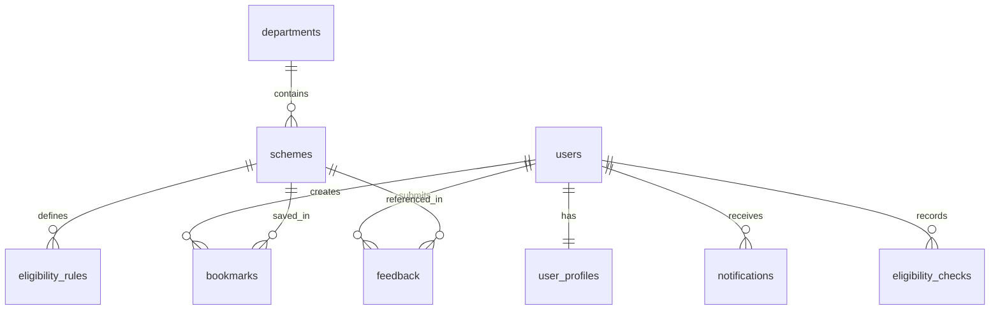

# Database Schema Documentation

Database: `government_scheme_db`  
ORM: Mongoose 8.x

## Collections Overview

---

## 1. `users`
Stores user credentials and authentication roles.

| Field | Type | Description |
|---|---|---|
| `_id` | ObjectId | Primary Key |
| `fullName` | String | Citizen's full name (required) |
| `email` | String | Unique email address (lowercase, indexed) |
| `phone` | String | Optional mobile phone number |
| `passwordHash` | String | bcrypt hashed password |
| `role` | String | `"USER"` or `"ADMIN"` (default `"USER"`) |
| `isActive` | Boolean | Account status flag (default `true`) |
| `createdAt` | Date | Timestamp |
| `updatedAt` | Date | Timestamp |

---

## 2. `user_profiles`
Stores persistent demographic and economic data used by the eligibility engine.

| Field | Type | Description |
|---|---|---|
| `_id` | ObjectId | Primary Key |
| `userId` | ObjectId | Foreign Key referencing `users._id` (unique) |
| `dateOfBirth` | Date | Birth date used to dynamically calculate age |
| `gender` | String | `"Male"`, `"Female"`, `"Transgender"`, `"Other"` |
| `state` | String | Permanent state of residence |
| `district` | String | District |
| `annualFamilyIncome` | Number | Combined family income in Indian Rupees (INR) |
| `education` | String | Highest qualification |
| `occupation` | String | Primary occupation (e.g. `"Farmer"`, `"Student"`) |
| `employmentStatus` | String | Employment classification |
| `community` | String | `"General"`, `"OBC"`, `"SC"`, `"ST"`, `"EWS"`, `"Minority"` |
| `disabilityStatus` | Boolean | Benchmark disability flag (PwD) |
| `otherDetails` | Object | Flexible dictionary for scheme-specific attributes |

---

## 3. `departments`
Represents official government ministries and executive departments.

| Field | Type | Description |
|---|---|---|
| `_id` | ObjectId | Primary Key |
| `departmentName` | String | Official department title (unique, indexed) |
| `slug` | String | URL slug (unique, indexed) |
| `description` | String | Department overview and portfolio |
| `ministryName` | String | Parent ministry |
| `officialWebsite` | String | Official portal URL |
| `contactInformation` | Object | Email, phone, address |
| `isActive` | Boolean | Status flag |

---

## 4. `schemes`
Stores comprehensive information on welfare programs, subsidies, and grants.

| Field | Type | Description |
|---|---|---|
| `_id` | ObjectId | Primary Key |
| `schemeName` | String | Official title of the scheme |
| `slug` | String | URL slug (unique, indexed) |
| `shortDescription` | String | Summary displayed on scheme cards |
| `fullDescription` | String | Detailed overview |
| `objectives` | Array[String] | Key mission objectives |
| `benefits` | Array[Object] | Structured benefits with `title`, `amount`, `description` |
| `category` | String | `"Agriculture"`, `"Healthcare"`, `"Housing"`, etc. |
| `schemeLevel` | String | `"Central"` or `"State"` |
| `applicableStates` | Array[String] | States eligible (or `["All India"]`) |
| `ministry` | String | Administering ministry |
| `departmentId` | ObjectId | Reference to `departments._id` (indexed) |
| `targetBeneficiaries` | Array[String] | Target groups (e.g. `"Farmers"`, `"Students"`) |
| `eligibilitySummary` | String | Human readable criteria summary |
| `requiredDocuments` | Array[Object] | Checklist with `name`, `mandatory`, `notes` |
| `applicationProcedure`| Array[String] | Step-by-step application instructions |
| `officialWebsite` | String | Portal URL |
| `officialApplicationUrl` | String | Direct application form URL |
| `officialStatusUrl` | String | Beneficiary tracking link |
| `sourceUrls` | Array[Object] | Verified source links |
| `verificationStatus` | String | `"VERIFIED"`, `"PARTIALLY_VERIFIED"`, `"NEEDS_VERIFICATION"` |
| `lastVerifiedAt` | Date | Verification timestamp |
| `isActive` | Boolean | Status flag |

---

## 5. `eligibility_rules`
Defines deterministic condition rules evaluated by the backend engine.

| Field | Type | Description |
|---|---|---|
| `_id` | ObjectId | Primary Key |
| `schemeId` | ObjectId | Reference to `schemes._id` (indexed) |
| `ruleName` | String | Name of the rule |
| `field` | String | Profile attribute (e.g. `annualFamilyIncome`, `age`, `occupation`) |
| `operator` | String | `==`, `!=`, `>`, `>=`, `<`, `<=`, `IN`, `NOT_IN`, `BETWEEN`, `EXISTS` |
| `expectedValue` | Mixed | Target value, list, or numeric threshold |
| `description` | String | Plain-English explanation note |
| `isMandatory` | Boolean | If true, failing this condition disqualifies the citizen |
| `isActive` | Boolean | Rule activation toggle |

---

## 6. `bookmarks`
User saved schemes and associated scheduled reminders.

| Field | Type | Description |
|---|---|---|
| `_id` | ObjectId | Primary Key |
| `userId` | ObjectId | Reference to `users._id` |
| `schemeId` | ObjectId | Reference to `schemes._id` |
| `reminder.enabled` | Boolean | Whether reminder is active |
| `reminder.reminderDate` | Date | Scheduled reminder timestamp (UTC) |
| `reminder.timezone` | String | IANA timezone (default `"Asia/Kolkata"`) |
| `reminder.message` | String | Optional citizen note |
| `reminder.status` | String | `"UPCOMING"`, `"TRIGGERED"`, `"COMPLETED"`, `"CANCELLED"` |
| `reminder.triggeredAt` | Date | Timestamp when notification was issued |
| `reminder.completedAt` | Date | Timestamp when marked completed |
